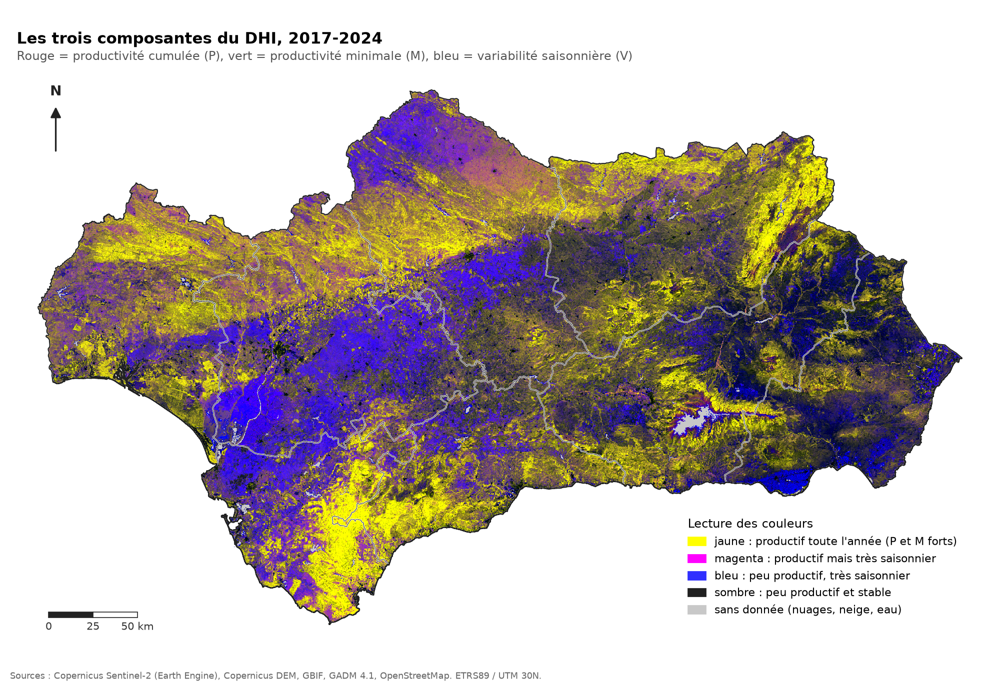
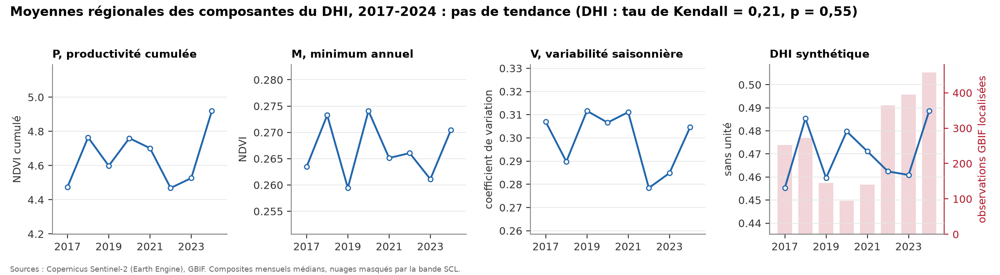
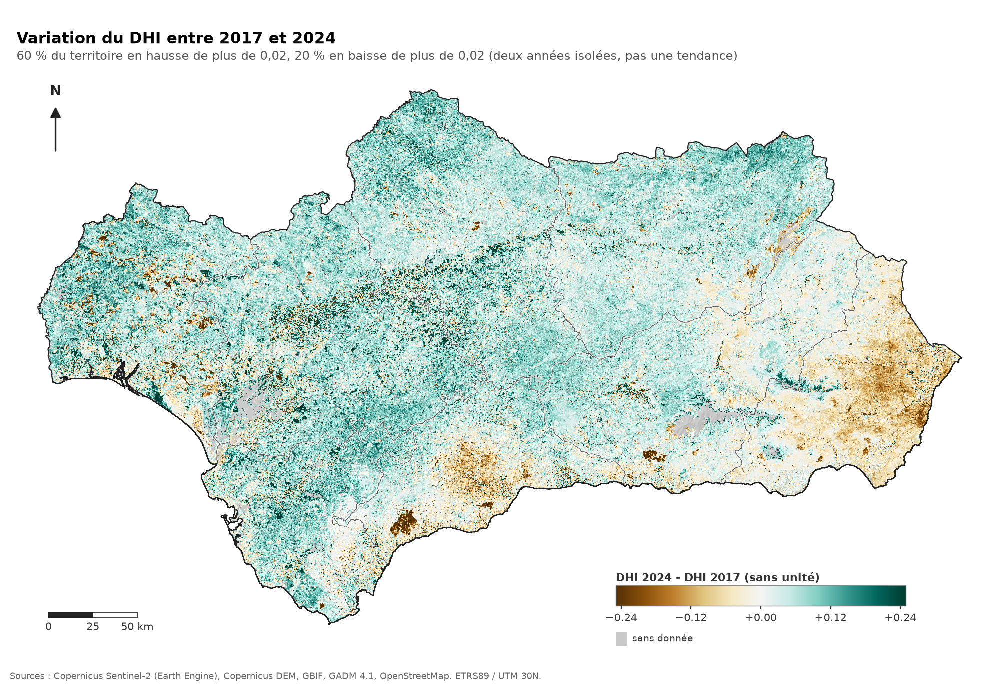
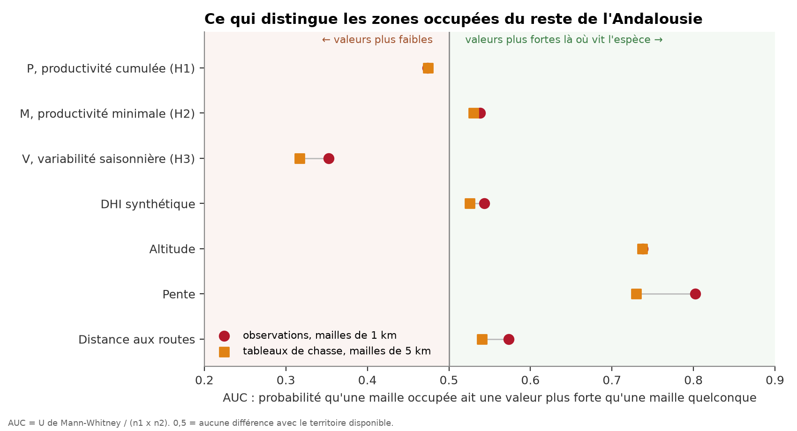
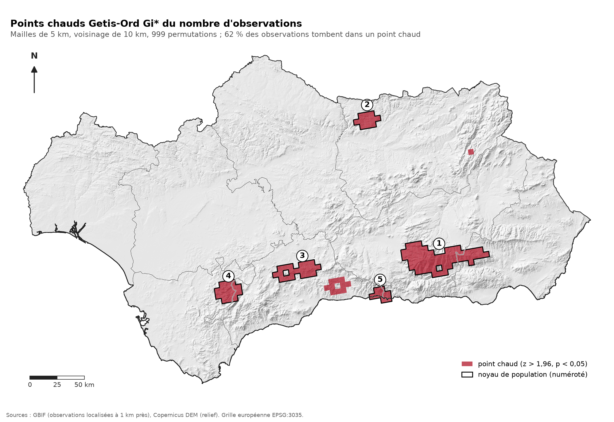
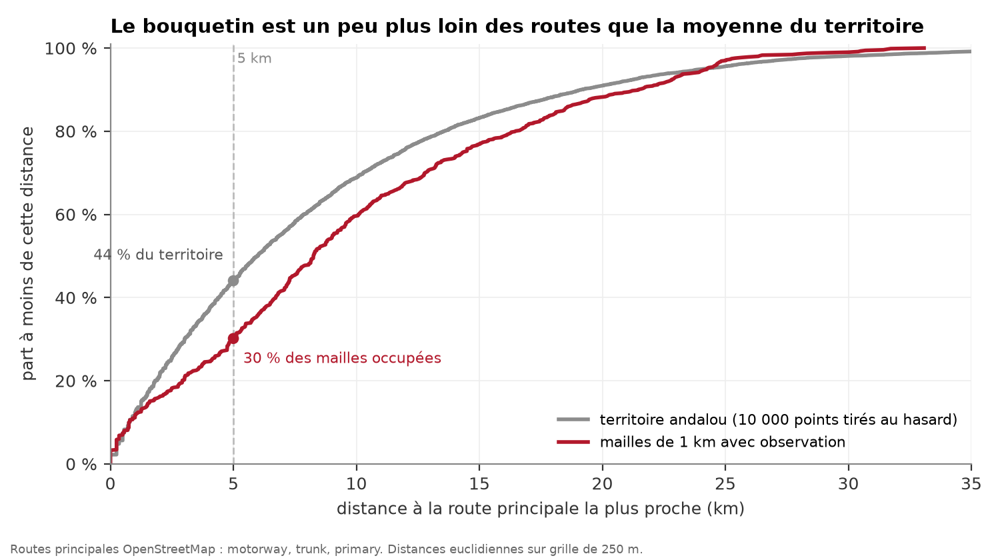
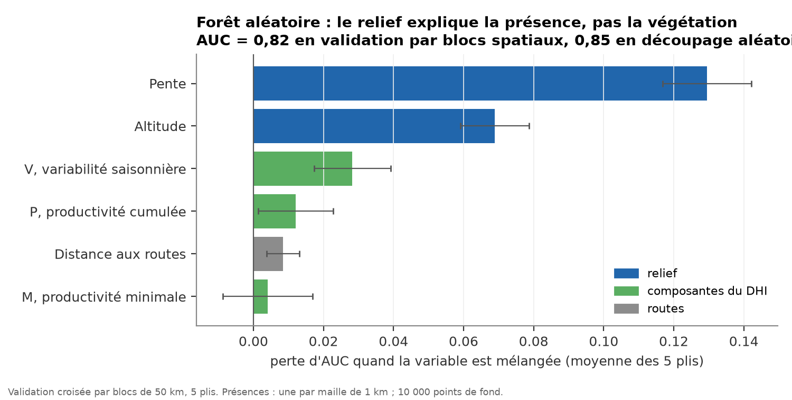
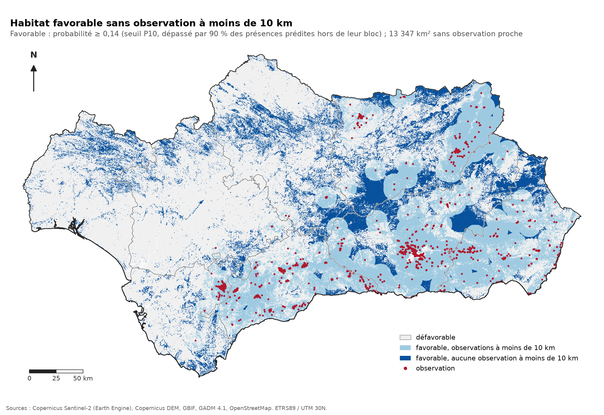
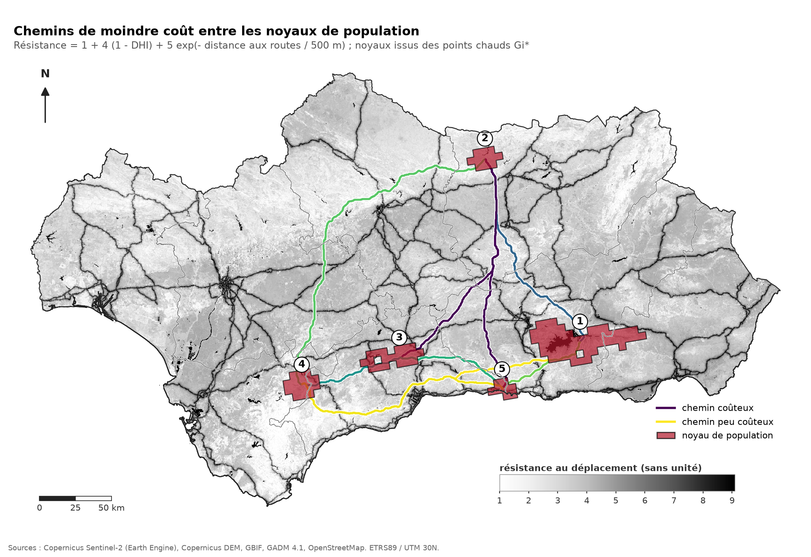

# Bouquetin ibérique et qualité de l'habitat en Andalousie (2017-2024)

La répartition du bouquetin ibérique (*Capra pyrenaica*) en Andalousie suit-elle la productivité de la végétation, mesurée par satellite ? Ce dépôt croise 8 ans d'observations GBIF avec les Dynamic Habitat Indices calculés sur Sentinel-2, puis ajoute autocorrélation spatiale, points chauds, effet des routes, modèle de présence et corridors entre noyaux de population.



## Question et hypothèses

Radeloff et al. (2019) résument une série annuelle de végétation en trois indices, chacun lié à une hypothèse écologique :

| Indice | Calcul ici (NDVI mensuel Sentinel-2) | Hypothèse testée |
|---|---|---|
| P, productivité cumulée | moyenne des mois disponibles x 12 | H1 : le bouquetin occupe les zones les plus productives |
| M, productivité minimale | NDVI du mois le plus bas | H2 : il occupe les zones où la période de stress est la moins marquée |
| V, variabilité | coefficient de variation des 12 mois | H3 : il occupe les zones les plus stables dans l'année |

Chaque hypothèse est testée avec sa propre composante, à deux échelles : les observations précises (mailles de 1 km) et les tableaux de chasse (mailles de 5 km). Un DHI synthétique (0,5 P + 0,3 M + 0,2 (1 - V), composantes normalisées) est aussi calculé pour la continuité avec le rapport d'origine.

## Ce qui a changé par rapport au rapport de janvier 2026

Ce travail a d'abord été rendu sous forme de dossier pour l'UE Analyse spatiale avancée du Master Géomatique (M2, 2025-2026). En le reprenant, plusieurs choix de méthode se sont révélés faux ou incomplets :

- Des « observations » qui sont surtout des tableaux de chasse. Sur les quelque 20 800 points du rapport, environ 18 000 viennent d'un seul jeu de données GBIF, les déclarations de prélèvements de chasse (IREC-CSIC, `BigGameBags`). Chaque ligne y est placée au centre d'une maille de 5 km de la grille européenne EPSG:3035, avec une incertitude de 3 535 m (la demi-diagonale de la maille), et datée à l'année seulement, de 2017 à 2021. Ces points ne disent rien à 250 m : leur distance à une route ou leur pixel de DHI est celle d'un centre de maille. Ils sont maintenant traités à part, à l'échelle de leur maille de 5 km, et les analyses fines n'utilisent que les observations dont la position est connue à 1 km près.
- Normalisation année par année. Chaque DHI annuel était ramené entre 0 et 1 avec le minimum et le maximum de l'année même. Les valeurs ne se comparaient donc plus d'une année à l'autre, et la « baisse de 18,9 % » comme les « 99,6 % du territoire en dégradation » pouvaient venir de la normalisation elle-même. Les composantes sont maintenant gardées brutes, et la normalisation du DHI synthétique utilise les mêmes bornes (2e et 98e centiles) pour les 8 années.
- H3 non testée. La composante V était fondue dans l'indice synthétique. Les trois composantes sont désormais exportées et testées séparément, comme le fait l'article.
- Points chauds sur une constante. La statistique Gi* était calculée sur une valeur de 1 pour chaque observation, ce qui ne mesure rien. Elle porte maintenant sur le nombre d'observations par maille de 5 km.
- I de Moran attribué aux observations. Le 0,583 du rapport portait sur le DHI des cellules, pas sur le nombre d'observations. Les deux sont maintenant calculés et nommés.
- Distances en degrés. La grille « 20 km » faisait 20 x 16 km et les distances aux routes étaient converties avec 1° = 111 km dans les deux directions. Tout est maintenant en ETRS89 / UTM 30N, en mètres.
- Évitement des routes sans point de comparaison. « 70,5 % des observations à plus de 5 km » ne dit rien sans la part du territoire elle-même à plus de 5 km. Les observations sont comparées au territoire disponible.
- Forêt aléatoire trop optimiste. 20 837 présences, souvent quasi superposées, contre 2 000 pseudo-absences, et un découpage aléatoire en apprentissage et test : la précision de 94 % mesurait surtout le déséquilibre et la proximité entre points. Le modèle utilise maintenant une présence par maille de 1 km, 10 000 points de fond, une validation croisée par blocs de 50 km, l'AUC et l'importance par permutation.
- Deux modèles différents. La carte venait d'une forêt et les chiffres d'une autre (paramètres et pseudo-absences différents). Il n'y en a plus qu'une.
- Résistance décrite et résistance calculée. Le rapport décrivait une résistance combinant DHI, pente et routes, le code n'utilisait que 1 - DHI. La résistance combine maintenant habitat et routes. La pente n'est pas pénalisée : le bouquetin recherche justement les terrains raides pour échapper aux prédateurs.
- Corridors entre centroïdes de provinces. Les extrémités des chemins sont maintenant les noyaux de population (groupes de mailles en point chaud), pas des centroïdes administratifs.
- Observations GBIF. Ajout de filtres pour les observations précises : présences seulement, incertitude de position de 1 km au plus, doublons (même point, même date) retirés. Il en reste 2 122, réparties dans 703 mailles de 1 km. Les tableaux de chasse couvrent 1 131 mailles de 5 km.

## Données

Les données brutes ne sont pas dans le dépôt. Trois téléchargements, à placer dans `donnees/brutes/` :

| Donnée | Où la trouver | À extraire dans |
|---|---|---|
| Observations GBIF de *Capra pyrenaica* | téléchargement GBIF https://doi.org/10.15468/dl.v2urfn (CSV simple) | `donnees/brutes/gbif/` (le seul `.csv`) |
| Limites administratives GADM 4.1 | https://geodata.ucdavis.edu/gadm/gadm4.1/shp/gadm41_ESP_shp.zip | `donnees/brutes/gadm/` (`gadm41_ESP_1.*` et `gadm41_ESP_2.*`) |
| Routes OpenStreetMap | https://download.geofabrik.de/europe/spain/andalucia-latest-free.shp.zip | `donnees/brutes/osm/` (`gis_osm_roads_free_1.*`) |

Sentinel-2 et le MNT (Copernicus DEM GLO-30, qui remplace le GMRT du rapport) sont lus directement dans Google Earth Engine.

## Lancer la chaîne

```
conda create -n bouquetin -c conda-forge python=3.12 geopandas pyogrio rasterio scikit-learn scikit-image esda libpysal matplotlib earthengine-api geemap
conda activate bouquetin
earthengine authenticate
```

Puis, depuis le dossier `scripts/` :

```
python 01_preparer_donnees.py
set EE_PROJECT=identifiant-du-projet-cloud   (PowerShell : $env:EE_PROJECT = "...")
python 02_dhi_earthengine.py
python 03_analyses.py
python 04_figures.py
```

L'étape 2 télécharge 33 rasters depuis Earth Engine et peut prendre une heure ; un raster déjà téléchargé n'est pas redemandé. L'étape 3 prend quelques minutes, l'étape 4 moins d'une minute.

## Organisation

```
scripts/commun.py                  chemins, projection, fonctions raster
scripts/01_preparer_donnees.py     zone, observations filtrées, mailles de chasse, routes, grilles de 20 et 5 km, points de fond
scripts/02_dhi_earthengine.py      composantes P, M, V par année et MNT (Earth Engine)
scripts/03_analyses.py             tests H1-H3, Moran, Gi*, routes, forêt aléatoire, corridors
scripts/04_figures.py              cartes et graphiques
resultats/                         tableaux CSV des résultats
figures/                           cartes et graphiques
```

## Résultats

Le relief explique la présence du bouquetin bien mieux que la végétation. Parmi les composantes du DHI, seule la faible variabilité saisonnière (H3) va dans le sens attendu, et le DHI de l'Andalousie ne baisse pas sur 2017-2024. Tous les chiffres ci-dessous sont dans `resultats/`.

### Pas de dégradation de l'habitat

Le DHI moyen de la région vaut 0,455 en 2017 et 0,489 en 2024, sans tendance sur les huit années (tau de Kendall = 0,21, p = 0,55). Entre 2017 et 2024, 60 % du territoire gagne plus de 0,02 et 20 % en perd autant ; les baisses se concentrent dans l'Almería et l'est de Málaga. Comparer deux années isolées reste fragile : 2017 et 2022 sont les deux années les moins productives de la série, 2024 la plus productive. La baisse de 18,9 % annoncée dans le rapport venait de la normalisation année par année.





### Les trois hypothèses de Radeloff et al.

L'AUC compare les valeurs aux présences et sur le territoire : 0,5 veut dire aucune différence, au-dessus de 0,5 les présences ont des valeurs plus fortes, en dessous des valeurs plus faibles.

| Hypothèse | Composante | AUC, mailles de 1 km avec observation | AUC, mailles de 5 km avec prélèvement | Lecture |
|---|---|---|---|---|
| H1, énergie disponible | P | 0,47 | 0,47 | non soutenue : les zones occupées sont un peu moins productives que la moyenne |
| H2, stress | M | 0,54 | 0,53 | effet très faible |
| H3, variabilité | V | 0,35 | 0,32 | soutenue : la végétation varie moins dans l'année là où l'espèce est présente |
| (comparaison) | pente | 0,80 | 0,73 | |
| (comparaison) | altitude | 0,74 | 0,74 | |

Les deux sources de données, indépendantes, donnent le même classement, et la grille de 20 km aussi (corrélation de Spearman entre nombre d'observations et V : -0,31, p < 0,001). Le résultat pour H3 tient probablement en partie au relief : les cultures de la vallée du Guadalquivir ont un NDVI très saisonnier, la végétation des sierras beaucoup moins. V garde pourtant un poids propre dans la forêt aléatoire, après la pente et l'altitude (voir plus bas).



### Répartition spatiale

Les observations sont fortement regroupées : I de Moran = 0,54 (p = 0,001) sur le logarithme du nombre d'observations par cellule de 20 km, et 165 cellules sur 262 sans aucune observation. À l'échelle des huit provinces, le Moran n'est pas significatif (0,085, p = 0,19), ce qui tient surtout au petit nombre d'unités. Le Gi* repère 122 mailles de 5 km en point chaud, qui contiennent 62 % des observations. Elles forment cinq noyaux : Sierra Nevada (1), nord de Jaén (2), Málaga (3), limite entre Cádiz et Málaga (4), côte entre Málaga et Granada (5).



### Routes

La distance médiane à une route principale est de 8,3 km pour les mailles occupées contre 6,0 km pour le territoire. À moins de 5 km d'une route, on trouve 30 % des mailles occupées et 44 % du territoire ; à moins de 500 m, 7 % et 6 %, sans écart. L'effet est réel mais modeste (AUC = 0,57) et se confond en partie avec le relief, puisque les sierras ont peu de grands axes.



### Modèle de présence

La forêt aléatoire atteint une AUC de 0,82 (écart-type 0,03) en validation par blocs de 50 km, contre 0,85 avec un découpage aléatoire. La pente fait perdre 0,13 d'AUC quand elle est mélangée, l'altitude 0,07, V 0,03 ; P, M et la distance aux routes pèsent peu. Avec le seuil P10 (probabilité de 0,14), 34 573 km² sont favorables, dont 13 347 km² à plus de 10 km de toute maille occupée, surtout dans les provinces de Jaén (3 357 km²), Córdoba (2 840 km²) et Granada (2 409 km²). Huelva, sans aucune observation, compte 1 383 km² favorables.





### Corridors

Les dix chemins de moindre coût entre les cinq noyaux mesurent de 73 à 264 km. Les liaisons les moins coûteuses par kilomètre relient la Sierra Nevada au noyau de la limite Cádiz-Málaga (1 vers 4) et ce dernier à la côte (4 vers 5), autour de 2,0 par km. Le noyau du nord de Jaén est le plus isolé : ses liaisons vers Málaga coûtent 2,7 par km, car elles doivent traverser la campagne cultivée et plusieurs grands axes routiers.



## Limites

- Les observations précises sont opportunistes : sentiers, refuges et zones touristiques sont surreprésentés. Garder une présence par maille de 1 km atténue l'effet des sites très fréquentés, sans le supprimer.
- Les tableaux de chasse montrent où l'espèce est chassée, pas où elle vit : les espaces protégés sans chasse en sont absents, et la pression de chasse suit la gestion des réserves autant que l'habitat.
- Le DHI a été conçu pour expliquer la richesse spécifique à large échelle, pas la présence d'une espèce donnée.
- Le NDVI de l'hiver est abaissé par la neige en Sierra Nevada, ce qui pèse sur la composante M en haute montagne.
- Les p-values des tests de Mann-Whitney et de Spearman supposent des points indépendants ; avec des données spatialement autocorrélées, il faut lire l'AUC et le rho comme des tailles d'effet plutôt que comme des tests.
- La résistance des corridors repose sur des poids choisis à dire d'expert, pas calibrés sur des déplacements réels.

## Références

- Radeloff, V. C. et al. (2019). The Dynamic Habitat Indices (DHIs) from MODIS and global biodiversity. *Remote Sensing of Environment*, 222, 204-214. https://doi.org/10.1016/j.rse.2018.12.009
- Getis, A. et Ord, J. K. (1992). The analysis of spatial association by use of distance statistics. *Geographical Analysis*, 24(3), 189-206.
- Anselin, L. (1995). Local indicators of spatial association, LISA. *Geographical Analysis*, 27(2), 93-115.
- Breiman, L. (2001). Random forests. *Machine Learning*, 45(1), 5-32.
- Roberts, D. R. et al. (2017). Cross-validation strategies for data with temporal, spatial, hierarchical, or phylogenetic structure. *Ecography*, 40(8), 913-929.
- Boakes, E. H. et al. (2010). Distorted views of biodiversity: spatial and temporal bias in species occurrence data. *PLoS Biology*, 8(6), e1000385.
- Pérez, J. M. et al. (2002). Distribution, status and conservation problems of the Spanish ibex, *Capra pyrenaica*. *Mammal Review*, 32(1), 26-39.
- GBIF.org (10 décembre 2025). GBIF Occurrence Download. https://doi.org/10.15468/dl.v2urfn
